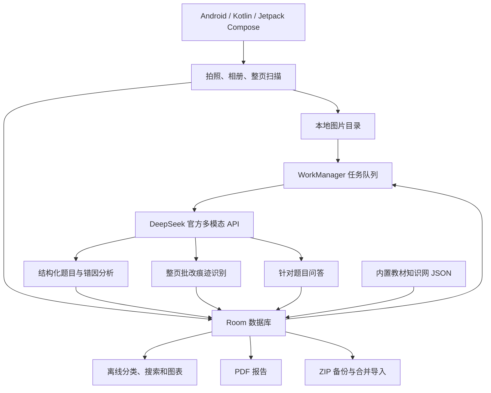

# AI 错题本

面向高中生的本地优先 Android 错题本。项目通过 DeepSeek 官方多模态 API 识别题目、分析错因、定位教材知识网，并支持整页批改痕迹识别和针对单题的连续问答。

[](https://github.com/XXYxiexieyu/ai-mistake-notebook/actions/workflows/android.yml)
[](LICENSE)

> 当前版本：`0.3.0-preview`。已在小米 15、小米 13 上分别完成安装和主要流程测试，当前运行正常。项目仍为个人预览版，尚未上架应用商店。

## 设计目标

### 1. 本地优先

- 已收录的错题、图片、问答、重考记录和教材知识树都保存在手机本地。
- 断网、未配置 API 密钥或 AI 服务不可用时，分类浏览、搜索、统计、PDF 和 ZIP 备份仍可使用。
- 新上传任务在本地持久化，恢复联网后由 WorkManager 继续。

### 2. AI 是辅助，不是唯一结论

- AI 识别结果作为默认值直接生效；用户仍可从编辑入口主动修改，但不会收到强制确认或纠错提示。
- 没有原作答证据时，错因只能作为候选。
- 支持“不补充错因”，避免系统把猜测写成确定诊断。
- 知识点无法匹配教材时显示为“未匹配”，人工调整仅作为可选入口。

### 3. 从错题整理延伸到学习诊断

- 分开保存“题目考什么”和“这次为什么错”。
- 支持原作答、草稿、具体错误小问或步骤。
- 用重考、可选评分调整和错题分布验证复习效果。
- 只收错题时不能计算完整“掌握率”，统计页面会明确这一限制。

### 4. 不依赖自建服务器

- 首版没有账号、云端数据库或自有后端。
- App 直接通过 HTTPS 调用 DeepSeek 官方 API。
- API 密钥由用户在 App 内配置，使用 Android Keystore 加密。
- 不启用 Android 系统自动云备份，换机使用用户主动导出的 ZIP。

## 功能

| 模块 | 功能 |
|---|---|
| 错题录入 | 拍照、相册、手动四角框选、透视校正 |
| 批量录入 | 多图导入、单图多题、AI 自动分题 |
| 批量 AI 分题 | 一键处理全部未分题页面，逐题预览并可单独删除 |
| 裁剪控制 | 四角透视校正，四边中点抓手可平行移动整条边 |
| 原作答提取 | 自动识别图片中的学生原作答、草稿和错误步骤并填入原作答字段 |
| 整页扫描 | 根据对错号、蓝笔/红笔订正、扣分和其他颜色批注识别错题，并生成彩笔增强图辅助判断 |
| 扫描进度 | 显示当前页的保存、彩笔增强、AI 分析和裁题入库阶段，可转到后台继续 |
| 跨页识别 | 单次最多 10 页，可按页排序；跨页大题合并为一个错题并纵向拼接题目图 |
| AI 分析 | 题干、答案、解析、题型、知识点、错因、难度和置信度 |
| 原作答证据 | 错误答案、草稿照片、具体小问或错误步骤 |
| 教材知识网 | 35 册教材、259 个单元、1156 个章节条目 |
| 知识网映射 | 将 AI 知识点对应到书目、单元和章节，支持模糊匹配标记 |
| 分类浏览 | 按科目、书目、单元、知识点、题型、日期和复习状态筛选 |
| 重复题 | 图片/文字相似检测、人工确认合并和错误次数累计 |
| 针对题目提问 | 连续 AI 问答，自动携带题目照片和分析上下文 |
| 重考 | 按科目与拍摄日期组卷、隐藏答案、计时、AI 判分，可选调整评分 |
| 统计 | 科目、状态、错因、知识点和易错知识点排行 |
| 总结层级 | 全部总结、各科目总结、各书目总结三级视图 |
| PDF | 仅导出错误知识点和错因总结，不包含具体题目 |
| 换机 | 普通 ZIP 完整导出、合并导入、重复题累计 |
| 数据提醒 | 一年前已重考通过错题的删除提醒，可在设置中关闭 |

## 技术架构



### 离线与在线边界

| 完全离线 | 需要网络/AI |
|---|---|
| 启动和进入各页面 | 自动分题 |
| 已有错题分类、筛选和搜索 | 题目 OCR、答案解析和错因分析 |
| 题目/原作答/聊天图片查看 | 整页批改痕迹识别 |
| 手动分类与标签修改 | 重考 AI 判分 |
| 本地图表和 PDF | 针对题目的 AI 问答 |
| ZIP 导出与合并导入 | 知识点的 AI 初次识别与建议 |
| 使用内置教材知识网 | 网络恢复后继续本地排队的任务 |

## 数据设计

Room 数据库当前为 v3。核心实体：

- `questions`：题目、答案、解析、错因、批改证据、知识网映射和复习状态。
- `retake_sessions` / `retake_items`：重考试卷、答案、计时、AI 判定与人工结果。
- `page_scans`：整页自动识别后台任务。
- `question_chat_messages`：针对单道题的本地问答历史。

图片以内部文件保存，数据库只保存相对路径。数据库升级使用显式迁移，不通过 destructive migration 清空数据。

### 知识网来源

35 册教材目录由 [电子课本网](http://www.dzkbw.com/) 的公开目录资料整理后内置为 `knowledge_tree.json`。App 运行时不抓取网页，因此知识树可离线使用。

AI 返回知识点后，本地匹配器会尝试定位：

```text
科目 → 教材书目 → 单元 → 章节 → 知识点
```

精确匹配和近似匹配会显示对应路径；未匹配项保留为“未匹配”，不会要求用户立即纠错。

## 项目结构

```text
app/src/main/java/com/hiro/mistakebook/
├─ ai/              DeepSeek 客户端和 WorkManager
├─ data/            Room、知识网、图片、PDF、ZIP
├─ ui/              Compose 页面和组件
├─ ui/theme/        视觉主题
├─ MainActivity.kt
└─ MainViewModel.kt

app/src/main/assets/knowledge_tree.json
app/src/main/res/                   Android 资源
app/src/test/                       单元测试
docs/                               需求与架构文档
tools/fetch_catalog.py              知识树生成工具
```

## 环境要求

- Android 10（API 29）及以上
- 当前目标 SDK：Android 15（API 35）
- JDK 17 或 21
- Gradle 8.9
- Android SDK Platform 35

## 构建

```bash
git clone https://github.com/XXYxiexieyu/ai-mistake-notebook.git
cd ai-mistake-notebook
./gradlew assembleDebug
```

APK 输出：

```text
app/build/outputs/apk/debug/app-debug.apk
```

运行完整检查：

```bash
./gradlew testDebugUnitTest lintDebug assembleDebug
```

项目内置目录抓取脚本用于更新知识树：

```bash
python tools/fetch_catalog.py
```

## 安装与配置

1. 从 [GitHub Releases](https://github.com/XXYxiexieyu/ai-mistake-notebook/releases) 下载预览 APK。
2. 在 Android 手机上允许文件管理器安装未知来源应用。
3. 打开 App，在设置中填写 DeepSeek 官方 API 密钥。
4. 不填写密钥时仍可使用已有数据的离线分类查看。

小米系统可能限制后台任务。若恢复网络后任务未继续，请在系统设置中允许“AI错题本”后台运行。

## 版本迭代

| 版本 | 主要变化 |
|---|---|
| `0.1.0-preview` | 本地优先错题本、六科知识树、AI 分析、重考、图表、PDF、ZIP 和一年提醒 |
| `0.1.1-preview` | 整页拍摄自动识别错题，根据红笔批改等痕迹筛选并保存依据 |
| `0.1.2-preview` | 单题连续问答、问答本地历史、知识点教材知识网映射 |
| `0.1.3-preview` | 增加彩色笔迹增强图，重点提升蓝色笔订正和圈划的整页识别能力 |
| `0.1.4-preview` | AI 知识点、原作答和错因默认生效；人工修改改为无提醒的可选入口 |
| `0.1.5-preview` | 修复框选页底部按钮遮挡，增加逐页扫描进度提示和后台运行状态 |
| `0.2.0-preview` | 支持多页上传、页序调整、跨页大题合并与多页区域拼接 |
| `0.2.1-preview` | 总结页改为全部/科目/书目三级视图，设置页版本号改为动态读取构建版本 |
| `0.3.0-preview` | 批量导入一键 AI 分题、逐题预览删除，裁剪框增加边平行移动抓手 |

详细记录见 [CHANGELOG.md](CHANGELOG.md)。

## 隐私与安全

- 题目图片只在 AI 分析、整页扫描或用户提问时发送给 DeepSeek 官方 API。
- API 密钥不会进入代码、日志或 ZIP 备份。
- ZIP 备份默认不加密；导出后需要用户自行保护。
- App 不启用 Android 自动云备份。
- 删除错题时会清理关联图片、重考记录和问答历史。

不要公开上传包含学生姓名、学校、成绩或其他个人信息的截图和日志。

## 当前限制

- 尚不支持两台手机自动同步。
- PDF 只输出知识点和错因汇总，不包含具体题目。
- 整页识别依赖 AI 对颜色、批改符号和版面的判断，结果需要人工复核。
- 仅收错题数据时，不能把错题占比解释为完整知识掌握率。

## 设备验证

- 小米 15：安装和主要流程运行正常。
- 小米 13：安装和主要流程运行正常。
- 两台设备均使用未 Root 的正式系统环境。

## 构建验证

- `assembleDebug`：通过。
- `testDebugUnitTest`：7 项通过，包括蓝笔颜色检测和 AI 默认值解析。
- `lintDebug`：0 个问题。
- GitHub Actions：通过。
- APK v2 签名：通过。

## 贡献

提交前请阅读 [CONTRIBUTING.md](CONTRIBUTING.md)。安全问题请按 [SECURITY.md](SECURITY.md) 私下报告。

## 许可证

项目使用 [MIT License](LICENSE)。

AI 模型输出仅供学习辅助，可能存在错误。重要结论应由用户或教师复核。
